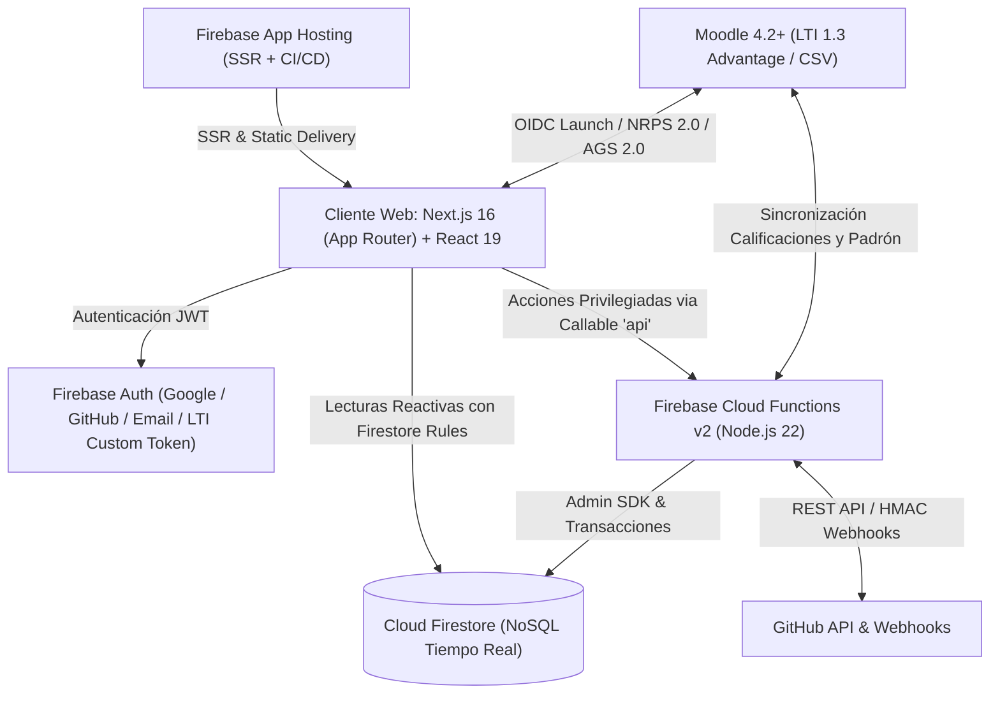
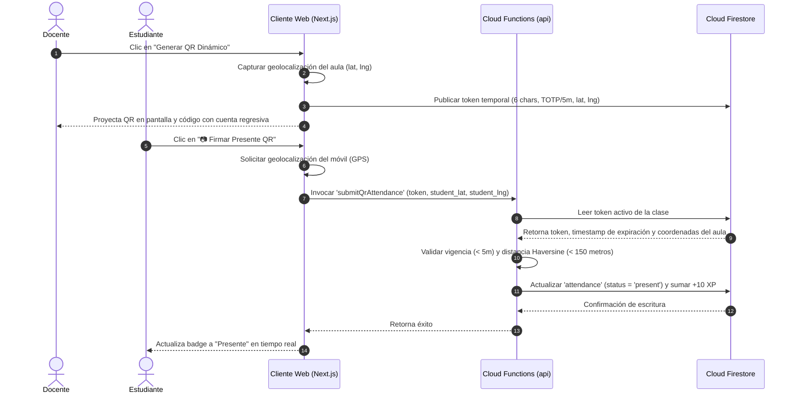
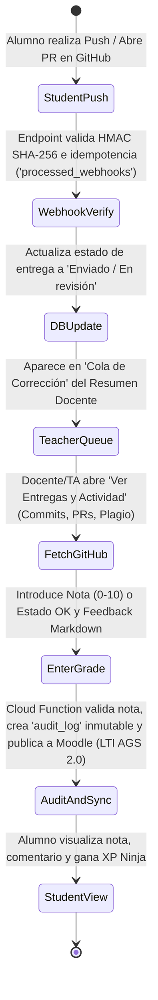
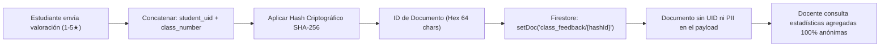

# Especificación Integral de Requerimientos, Arquitectura y Producto: CRM Estudiantil — Ninja Dojo (Jutsu Classroom)

Este documento unifica la especificación funcional, reglas de negocio académicas (UNRN), arquitectura técnica serverless (Next.js + Firebase), integración **LTI 1.3 Advantage** con Moodle y GitHub, sistema de diseño institucional (**Academic Excellence**), catálogo de casos de uso de punta a punta y el plan estratégico de mejoras del proyecto **Ninja Dojo (Jutsu Classroom)**.

---

## 1. Arquitectura de Datos, Reglas de Negocio y Entidades Principales

### 1.1. Entidad: Estudiante (Padrón, Credenciales y Gamificación)

Representa los datos base del alumno en la colección `profiles`, sus múltiples identidades digitales, su membresía en cursadas (`enrollments` / `course_roster`) y su progreso gamificado.

* **Legajo / Matrícula Institucional (`matricula_unrn`):** Formato estricto `UNRN-<números>` (ej. `UNRN-15772`), validado mediante expresión regular (`^UNRN-\d+$`). Proveniente de SIU Guaraní o del campo `lis_person_sourcedid` provisto por Moodle vía LTI 1.3.
* **Identificador Abstracto (`student_uuid` / Firebase `uid`):** Token alfanumérico único no secuencial (ej. `st_8f9d2a1b4c`) utilizado en todas las rutas REST y referencias documentales para no exponer información personalmente identificable (PII) como DNI o legajo en las URLs.
* **Apellido y Nombre (`full_name`):** Almacenados para ordenamiento alfabético e identificación en grillas y foros.
* **Correos Electrónicos Múltiples (Relación $1:N$):** Un mismo legajo puede asociar múltiples direcciones de correo (institucional `@unrn.edu.ar`, personal, correo de commits en GitHub), permitiendo conciliar su actividad sin importar desde qué cuenta interactúe.
* **Identificadores Externos:**
  * `github_username`: Usuario de GitHub vinculado mediante OAuth para seguimiento de repositorios, commits y Pull Requests.
  * `moodle_user_id`: ID numérico interno de Moodle (ej. `19284`), obtenido automáticamente en el lanzamiento LTI o al importar lotes CSV de telemetría.
  * `lti_user_sub`: Identificador opaco estandarizado OIDC emitido por la plataforma Moodle durante el handshake LTI 1.3.
* **Comisión y Grupo (`commissions` / `study_groups`):** Mapeo de la comisión asignada por materia (`Record<CourseId, CommissionCode>`) y pertenencia a grupos de estudio o equipos de trabajo práctico.
* **Estado de Cuenta y Condición Académica:**
  * `account_status`: `pending` | `approved` | `rejected` (controlado por el administrador o auto-aprobado vía LTI/código de invitación).
  * `academic_condition`: Estado calculado en tiempo real o fijado en cierre de acta (`Regular`, `Promocionado`, `Condicional`, `EN RIESGO`, `Baja`, `Ausente`).
* **Excepciones de Cursada:** Banderas y notas de excepción individual justificadas (ej. eximición de porcentaje de asistencia por certificado laboral o superposición horaria).
* **Progreso y Gamificación Dinámica (Rango Ninja):**
  * Cálculo en tiempo real de experiencia (**XP**) sin escrituras redundantes en base de datos:
    $$\text{Total XP} = (\text{Asistencias/Tardanzas} \times 10) + (\text{Entregas} \times 50) + \sum (\text{Nota} \times 5) + (\text{Comentarios Foro} \times 10) + (\text{Soluciones Aprobadas} \times 100)$$
  * **Nivel y Rango:** $\text{Nivel} = \lfloor \text{Total XP} / 100 \rfloor + 1$. Rangos: `Genin` ($\text{Nivel} < 3$), `Chūnin` ($3 \le \text{Nivel} < 5$) y `Jōnin` ($\text{Nivel} \ge 5$).
  * **Medallas de Honor (Badges):**
    * `🥇 Maestro de Chakra`: Promedio general de notas $\ge 9$.
    * `🥈 Asistencia Perfecta`: Asistencia $= 100\%$ (con al menos $3$ clases registradas).
    * `🥉 Ninja Activo`: $\ge 3$ participaciones en foros de clase.
    * `🎖️ Solucionador`: $\ge 1$ respuesta marcada como solución oficial por el docente.

---

### 1.2. Módulo: Seguimiento de Entregas, Pull Requests y Reglas de Aprobación

Sustituye las hojas manuales de seguimiento por una matriz reactiva conectada a GitHub (`assignments` y `submissions`):

* **Trabajos Prácticos y Tareas (`assignments`):**
  * **Atributos:** Título, descripción en Markdown sanitizado, repositorio plantilla (`owner/repo`), fecha de publicación, fecha límite (`deadline`) y margen de tolerancia configurable (ej. $48\text{ hs}$ hábiles/corridas).
  * **Estados de Entrega (`submissions.status`):** `Pendiente`, `Enviado / En revisión (PR abierto)`, `Cambios solicitados (Reentrega)`, `OK (Aprobado / Check Verde)` o `Ausente / Sin entregar`.
  * **Calificación Numérica y Conceptual (`grade`):** Validada estrictamente en servidor en escala $0$ a $10$ (soportando decimales con coma o punto y estados conceptuales) junto con retroalimentación (`feedback`) en Markdown.
  * **Control de Vencimientos:** Si la entrega supera el `deadline` más el margen de tolerancia, se etiqueta automáticamente como `Fuera de término`, a menos que posea una **Excepción Puntual** otorgada por la cátedra.
  * **Detección de Plagio en Código:** Motor de similitud sintáctica (basado en k-gramas e índice de Jaccard) que compara los repositorios entregados y alerta al docente si dos entregas superan el umbral configurable (ej. $85\%$ de similitud estructural).

* **Reglas Parametrizables de Regularidad y Promoción por Comisión:**
  * **Asistencia Mínima:** Umbral configurable por curso/comisión (por defecto $75\%$), con soporte de excepciones individuales.
  * **Condición de Regularidad:** Requiere el $100\%$ de los Trabajos Prácticos obligatorios entregados (con posibilidad de exceptuar un TP puntual justificadamente) y aprobar las instancias parciales o sus recuperatorios (R1, R2) con nota $\ge 4$.
  * **Condición de Promoción:** Requiere alcanzar un porcentaje configurable de Trabajos Prácticos en estado `OK` / Check Verde (por defecto $\approx 80\%$), no superar el máximo permitido de entregas `Fuera de término`, obtener nota de promoción en los parciales (ej. $\ge 7$ o $\ge 8$) y cumplir el parámetro booleano de la comisión: *"Permite promocionar rindiendo recuperatorio (Sí/No)"*.

---

### 1.3. Módulo: Bitácora de Contacto, Alertas Tempranas (`EN RIESGO`) y Consultas

Evoluciona la columna manual `CONTACTAR` hacia un motor proactivo de retención estudiantil:

* **Disparadores Automáticos de Alerta y Estado `EN RIESGO`:**
  1. **`⚠️ Asistencia Crítica`:** El alumno posee menos del $75\%$ de asistencia acumulada (evaluado tras al menos $3$ clases dictadas) o registra $X$ inasistencias consecutivas (ej. $2$ o $3$ ausencias seguidas).
  2. **`⚠️ Tareas Atrasadas`:** El alumno registra trabajos prácticos vencidos sin entrega ni Pull Request abierto.
  3. **`⚠️ Sin Repositorio`:** Transcurridos $N$ días (por defecto $7$ días) desde el lanzamiento de una práctica sin que exista el repositorio del alumno en la organización de GitHub.
  4. **`⚠️ Deserción Silenciosa (Actividad sin Entrega)`:** El alumno no registra commits ni PR en la práctica activa, pero **sí registra actividad reciente en Moodle** (vía lanzamiento LTI 1.3 o eventos en el último CSV importado). Detecta alumnos que siguen intentando cursar pero están bloqueados técnicamente.
* **Ciclo de Vida de la Alerta y Acciones Rápidas:**
  * Estados: `Activa`, `En seguimiento (Contactado)` y `Resuelta / Posponer por N días` (evita re-disparos molestos al día siguiente).
  * Desde la tarjeta de **Alumnos que requieren Atención**, el docente dispone de acciones en un clic: **"Enviar Correo de Alerta"** (`mail` module) y **"Agendar Tutoría"**.
* **Historial de Interacciones (Timeline Docente):** Registro cronológico inmutable con fecha/hora, docente/TA interviniente, canal (Email, Discord, Moodle, Presencial) y resumen.
* **Foros Q&A por Clase y Consultas de Revisión:**
  * Cada instancia de clase posee un hilo de comentarios (`class_comments`) con soporte Markdown, reacciones (`👍`, `🎉`) y marcado de **Mejor Respuesta / Solución Oficial** (`is_solution: true`) por parte del docente (que otorga $+100\text{ XP}$ al autor y notifica al alumno).
  * Los estudiantes pueden abrir tickets contextuales sobre cualquier celda de su ficha (ej. discrepancia en una asistencia o duda sobre una corrección de PR).

---

### 1.4. Módulo: Cronograma Inteligente, Asistencia QR con GPS y Feedback Anónimo

* **Planificación y Cronograma Versionado (`classes` y `schedule_versions`):**
  * Definición de horarios semanales base (Día, Hora, Duración en bloques, Tipo: `Teórica`, `Práctica`, `Laboratorio`, `Evaluación`) y generación automática de todas las clases del cuatrimestre.
  * **Tablero Kanban Curricular:** Vista interactiva Drag & Drop (y accesible por teclado) con 4 columnas (`Teóricas`, `Prácticas`, `Feriados / Sin Clase`, `Especiales`) para reorganizar la cursada en caliente.
  * **Control de Versiones del Cronograma:** Creación de snapshots con nombre (ej. *"Planificación Post-Parcial"*), comparador visual de diferencias (**Diff interactivo** de clases añadidas, movidas o modificadas) y restauración en un clic.
  * **Integración con Google Meet y YouTube:** Enlace global de videollamada pre-completado por clase y botón `YT` con OAuth de YouTube para listar grabaciones subidas, vincular el video a la clase y renombrar su título automáticamente a `"Clase X: Tema"`.
* **Control de Asistencia Manual y Dinámica vía QR + Geolocalización (`attendance`):**
  * **Carga Manual / Filtrada por Comisión:** Estados `Presente (present)`, `Ausente (absent)`, `Tarde (late)`, `Justificado (justified)`.
  * **Asistencia QR Dinámica con Validación GPS:**
    1. El docente presiona **"Generar QR Dinámico"** en el aula; el sistema captura las coordenadas `(lat, lng)` del aula y genera un token temporal de $6$ caracteres con expiración de $5$ minutos (y rotación TOTP antireplay).
    2. El estudiante escanea el QR o ingresa el token desde su móvil (**"📷 Firmar Presente QR"**), concediendo permiso de geolocalización.
    3. La Cloud Function `submitQrAttendance` valida que el token esté vigente y que la distancia Haversine entre el alumno y el aula sea $< 150\text{ metros}$, registrando el presente en tiempo real.
* **Feedback Anónimo por Clase mediante Hashing SHA-256 (`class_feedback`):**
  * Al finalizar una clase, el alumno puede calificarla ($1\text{ a }5$ estrellas), indicar su nivel de comprensión y dejar sugerencias escritas.
  * **Anonimización Criptográfica:** El ID del documento en Firestore se calcula como $\text{SHA-256}(\text{student\_uid} + \text{class\_number})$ (hexadecimal de $64$ caracteres) sin almacenar ningún dato del alumno en el cuerpo del documento. Esto garantiza **anonimato total** ante el docente pero permite que el alumno recupere y edite su propia evaluación sin duplicar votos.

---

### 1.5. Módulo: Comunidad Estudiantil (Tutorías entre Pares y Grupos de Estudio)

* **Sistema de Tutorías Académicas (`tutors` y `tutoring_sessions`):**
  * Alumnos avanzados pueden postularse como tutores indicando sus temas fuertes y disponibilidad horaria.
  * Otros estudiantes pueden reservar sesiones de mentoría indicando el tema de consulta y fecha/hora propuesta.
  * Al confirmar el tutor la solicitud (`status: 'confirmed'`), el sistema genera y habilita automáticamente una sala virtual de Google Meet (`meet_url`).
* **Grupos de Estudio y Emparejamiento Inteligente (`study_groups`):**
  * Creación de grupos de estudio con nombre, descripción y preferencia de banda horaria (`Mañana`, `Tarde`, `Noche`).
  * Motor de **Emparejamiento Inteligente** que permite buscar y contactar compañeros de la cátedra que compartan la misma disponibilidad horaria.

---

## 2. Arquitectura Técnica del Sistema, Seguridad (RBAC) y Esquema de Rutas

### 2.1. Stack Tecnológico Serverless Híbrido

* **Frontend:** Next.js 16 (App Router) con React 19, TypeScript estricto (`strict: true`), Tailwind CSS, carga diferida de paneles secundarios (`next/dynamic`) y caché offline multi-pestaña en IndexedDB (`persistentLocalCache` + `persistentMultipleTabManager`).
* **Backend Serverless:** Firebase Cloud Functions v2 sobre Node.js 22, modularizado por dominio en `functions/src/modules/` (`auth`, `course`, `github`, `attendance`, `calendar`, `mail`, `moodle`, `study_groups`, `tutoring`) con despachador centralizado `api` y capa declarativa de autorización en `functions/src/authz.js`.
* **Base de Datos:** Cloud Firestore con reglas de seguridad estrictas (`firestore.rules`) bajo principio de denegación por defecto.

---

### 2.2. Modelo de Seguridad, Roles (RBAC) y Mapeo LTI 1.3

El control de acceso opera en tres capas sincronizadas: **Firestore Security Rules**, **Políticas declarativas en Cloud Functions (`authz.js`)** y **Mapeo de Roles LTI 1.3**:

| Rol en el Sistema | Mapeo Estándar LTI 1.3 (`roles` claim) | Permisos y Alcance Operativo |
| :--- | :--- | :--- |
| **Administrador (`admin`)** | `.../institution/person#Administrator` | Control total de usuarios (`profiles`), aprobación de cuentas, creación/archivo de cátedras, backups globales y auditoría. |
| **Profesor Titular (`teacher` - `titular`)** | `.../membership#Instructor` | Configuración total de la cátedra, reglas de aprobación, horarios, co-docencia, integraciones LTI/GitHub, importación CSV y cierre de actas. |
| **Ayudante de Cátedra (`teacher` - `ayudante` / TA)** | `.../membership/Instructor#TeachingAssistant` | Filtrado por su comisión asignada, toma de asistencia, revisión de PRs, calificación de entregas, gestión de alertas y respuesta en foros. Sin permisos destructivos ni cambio de reglas globales. |
| **Estudiante (`student`)** | `.../membership#Learner` | Acceso SSO desde Moodle o login directo a su ficha, cronograma, firma de asistencia QR, entrega de TPs, visualización de commits/notas, feedback anónimo, tutorías y grupos de estudio. |

#### Reglas de Blindaje Arquitectónico:
1. **IDs de Membresía Predecibles ($O(1)$ en Reglas):** La pertenencia a un curso se verifica mediante documentos con clave compuesta determinista (`course_teachers/{courseId}_{uid}`, `course_roster/{courseId}_{uid}`, `enrollments/{uid}_{courseId}`) utilizando `exists()` sin lecturas adicionales facturables.
2. **Protección contra Escalada de Privilegios:** Ningún cliente puede modificar su propio campo `role` ni `account_status` en `profiles/{uid}`. Toda escritura en colecciones críticas (`submissions`, `audit_logs`, `activity_logs`, `backups`, `announcements`, `notifications`, `tutoring_sessions`) se realiza exclusivamente vía Cloud Functions con validación de esquema.
3. **Proyección Segura para Estudiantes:** Las respuestas del backend dirigidas a alumnos filtran secretos de curso (`sync_secret`, códigos de invitación docentes y tokens de API).

---

### 2.3. Esquema de Rutas App Router, Endpoints de Autenticación y URLs REST

#### Matriz de Autenticación de Endpoints (`src/app/api/`):

| Esquema de Seguridad | Middleware / Helper (`src/app/api/middleware/api.ts`) | Rutas Protegidas | Consumidor Principal |
| :--- | :--- | :--- | :--- |
| **Token de Suscripción Docente (`sync_secret`)** | `requireCourseSubscriptionToken` (comparación en tiempo constante) | `/api/calendar`, `/api/export/csv` | Google Sheets (`IMPORTDATA`) / Clientes iCal docentes |
| **Token de Calendario Estudiantil (`calendar_secret`)** | `requireCourseSubscriptionToken(..., { allowCalendarToken: true })` | `/api/calendar` | Google Calendar / Apple Calendar de alumnos (Solo lectura `.ics`) |
| **Bearer JWT de Firebase Auth** | `requireBearerUser` / `requireBearerProfile` | `/api/me`, `/api/cli/*` | Dojo CLI (modo cloud) y clientes autenticados |
| **Handshake OIDC / JWT Asimétrico RS256** | Validación contra JWKS de Moodle (`/mod/lti/certs.php`) | `/api/v1/lti/login_initiations`, `/api/v1/lti/launch`, `/api/v1/lti/jwks` | Plataforma Moodle 4.2+ (UNRN) |
| **Firma HMAC-SHA256 (`X-Hub-Signature-256`)** | `verifyGithubWebhook` + deduplicación `processed_webhooks` | `/api/github/webhook` | Eventos Push / Pull Request / Autograding de GitHub |
| **Monitoreo Público / Profundo** | Verificación de lectura en Firestore y latencia GitHub opcional | `GET /api/health` (`?deep=1`) | Monitores de disponibilidad (Uptime Kuma / Pingdom) |

#### Estructura Jerárquica de URLs Semánticas y Abstractas (Sin PII):
Para la navegación web y enlaces profundos (*Deep Linking*), se utiliza el esquema jerárquico libre de datos personales en la URL:
`/{asignatura}/{anio}/{cuatrimestre}/{comision}/...`

* **Vista General de la Comisión (Resumen Docente, Planilla y Alertas):**
  `GET /b6003-programacion-1/2026/1c/comision-1/planilla`
* **Ficha Individual del Estudiante (Vista Alumno / SSO LTI Launch):**
  `GET /b6003-programacion-1/2026/1c/comision-1/estudiantes/st_8f9d2a1b4c`
* **Detalle de Prácticas, Commits y Pull Requests del Estudiante:**
  `GET /b6003-programacion-1/2026/1c/comision-1/estudiantes/st_8f9d2a1b4c/practicas/tp-1`
* **Registro de Asistencias y Excepciones del Estudiante:**
  `GET /b6003-programacion-1/2026/1c/comision-1/estudiantes/st_8f9d2a1b4c/asistencias`
* **Administración de Reglas, Padrón NRPS, Publicación AGS y Cierre de Actas:**
  `GET|PUT /b6003-programacion-1/2026/1c/comision-1/admin/configuracion`
  `POST /b6003-programacion-1/2026/1c/comision-1/admin/lti/nrps-sync`
  `POST /b6003-programacion-1/2026/1c/comision-1/admin/lti/ags-publish`
  `POST /b6003-programacion-1/2026/1c/comision-1/admin/integraciones/moodle-csv`
  `POST /b6003-programacion-1/2026/1c/comision-1/admin/cierre-cursada`

---

## 3. Motor de Integraciones: GitHub, Moodle (LTI 1.3 + CSV) y Google Sheets

### 3.1. Integración con GitHub (Repositorios, Commits, PRs e Inline Grading)

1. **Idempotencia y Seguridad de Webhooks:**
   * Todo webhook entrante verifica su firma criptográfica `X-Hub-Signature-256` y registra su ID de entrega (`X-GitHub-Delivery` / `X-Dojo-Delivery`) en la colección `processed_webhooks` (con TTL de $30$ días), garantizando procesamiento exacto una única vez ante reintentos de red.
2. **Sincronización Automática de Estados de Entrega:**
   * **Detección de Creación de Repo:** Verifica qué alumnos aceptaron la tarea en GitHub Classroom; si pasa $1$ semana sin repo, dispara la alerta `CONTACTAR (Sin Repo)`.
   * **PR Abierto / Push de nuevos Commits:** Actualiza la entrega a `Listo para corregir (Entregado / Reentregado)`, calcula si ingresó dentro del margen de tolerancia y lo encola en la tarjeta **"Cola de Corrección de Trabajos"** del Resumen Docente.
   * **PR Review = `Changes Requested`:** Registra el intento, almacena el comentario del TA y cambia el estado a `Reentrega Pendiente`.
   * **PR Review = `Approved` o Calificación Inline en Dojo:** Marca el TP con **Check Verde (`OK`)**, guarda la nota validada ($0\text{ a }10$), genera una entrada inmutable en `audit_logs` y actualiza el progreso de promoción y el XP Ninja del alumno.

---

### 3.2. Integración Nativa con Moodle vía Estándar LTI 1.3 Advantage

El sistema actúa como **LTI 1.3 Tool Provider** conectándose al campus Moodle de la UNRN mediante el módulo estándar `mod_lti`:

1. **OIDC Third-Party Initiated Login y Redirección Contextual:**
   * Valida el `id_token` JWT firmado con RS256 contra el conjunto de claves públicas (JWKS) de Moodle.
   * Actualiza instantáneamente `ultima_actividad_moodle` del alumno.
   * Si el usuario es `Instructor` o `TeachingAssistant`, aterriza en la subpestaña **📊 Resumen** de la comisión; si es `Learner`, aterriza en su dashboard personal con su **Rango Ninja** y estado de entregas.
   * Si el alumno ingresa por primera vez vía LTI y no tiene cuenta de GitHub asociada, se dispara el asistente de **Onboarding OAuth con GitHub** para vincular `UNRN-<números>` $\leftrightarrow$ `moodle_user_id` $\leftrightarrow$ `github_username`.
2. **Sincronización de Padrón y Co-Docencia (LTI NRPS v2.0):**
   * Consulta el endpoint de membresía de Moodle, importando alumnos y ayudantes con su `moodle_user_id`, email institucional y legajo alojado en `lis_person_sourcedid`. Calcula un checksum SHA-256 del padrón para ejecutar escrituras solo cuando existan altas o bajas reales.
3. **Sincronización del Libro de Calificaciones (LTI AGS v2.0):**
   * Publica las calificaciones normalizadas (convirtiendo correctamente la escala $0\text{–}10$ al porcentaje o escala máxima del *Line Item* en Moodle) junto con el comentario de retroalimentación.
4. **Enlaces Profundos (LTI Deep Linking 2.0):**
   * Permite incrustar en cada unidad temática de Moodle accesos directos a una práctica o clase específica dentro de Dojo.

---

### 3.3. Ingesta Complementaria de Telemetría CSV de Moodle y Exportación a Google Sheets

* **Importador Idempotente de Logs CSV de Moodle:**
  * Procesa los archivos de actividad exportados de Moodle extrayendo el ID mediante la expresión regular `user with id '(\d+)'` sobre la columna `Descripción`.
  * Genera un hash único por evento (`moodle_user_id` + `Hora` + `Nombre evento` + `Contexto`) para permitir la carga de archivos con fechas solapadas sin duplicar registros.
  * Alimenta el detector de **Deserción Silenciosa** (alumnos con actividad reciente en el campus pero sin commits ni PRs en GitHub).
* **Sincronización con Google Sheets y Exportación Institucional (SIU Guaraní):**
  * **Botón "📊 Exportar Planilla (Sheets)" y Endpoint `/api/export/csv`:** Genera un archivo CSV con codificación universal compatible con Excel y Google Sheets (o conectable en vivo mediante `=IMPORTDATA("https://.../api/export/csv?token=...")`) que incluye: Matrícula (`UNRN-XXXXX`), Nombre, Email, Comisión, nota de cada TP y Parcial, promedio general, porcentaje de asistencia, alertas activas y condición final de cursada.

---

## 4. Sistema de Diseño e Interfaz de Usuario: "Academic Excellence" & Modo Dojo

La interfaz combina una arquitectura de información académica de alta legibilidad (**Academic Excellence**) con soporte para el tema oscuro de desarrollo (**Modo Ninja Dojo**) y cumplimiento de accesibilidad **WCAG 2.1 Nivel AA**.

### 4.1. Paleta de Colores Institucional y Tokens Semánticos

| Token de Diseño | Valor Hex | Propósito en la Interfaz |
| :--- | :--- | :--- |
| **`primary` / `unrn-red`** | `#A10016` / `#ED1C24` | Identidad institucional UNRN, acciones primarias (CTAs), encabezados destacados y bordes de foco activo. |
| **`secondary`** | `#545F73` | Base tipográfica secundaria, estructura de navegación y contenedores neutros (`secondary-container`: `#D5E0F8`). |
| **`tertiary`** | `#004BA4` | Enlaces interactivos, indicadores de sincronización LTI/GitHub y acentos informativos (`tertiary-container`: `#0062D2`). |
| **`surface` / `background`** | `#F7F9FB` / `#FFFFFF` | Superficie base de bajo cansancio visual (`surface`) y tarjetas de contenido puro (`surface-container-lowest`). En modo oscuro: `#1F1F1F` / `#0A0A0A`. |
| **`border-subtle`** | `#E2E8F0` | Bordes de $1\text{px}$ (*Ghost Borders*) para delimitar tarjetas y tablas sin recurrir a sombras pesadas. |
| **`error` / Alertas** | `#BA1A1A` | Estados de error en formularios y badges de riesgo crítico (`error-container`: `#FFDAD6`, texto `#93000A`). |

### 4.2. Tipografía, Grilla Fluida y Componentes Accesibles

* **Sistema Tipográfico Unificado (`Chivo` via `next/font/google`):**
  * `display`: $40\text{px}$ / $48\text{px}$ (`font-weight: 800`, `-0.02em`) para cabeceras de cátedra.
  * `headline-lg` / `headline-md`: $32\text{px}$ y $24\text{px}$ (`700`/`600`) para títulos de módulos y métricas de resumen.
  * `body-lg` / `body-md`: $18\text{px}$ y $16\text{px}$ (`400`, altura de línea $1.5\times$) para consignas y foros.
  * `label-lg` / `label-md`: $14\text{px}$ y $12\text{px}$ (`600`/`500`) para botones, cabeceras de grilla y chips de estado.
* **Layout, Espaciado y Geometría:**
  * Escala base de $4\text{px}$ / $8\text{px}$ (`xs: 4px`, `sm: 8px`, `md: 16px`, `lg: 24px`, `xl: 32px`, `xxl: 48px`) sobre grilla de $4$ columnas en móvil y $12$ columnas en escritorio.
  * Áreas táctiles mínimas de $48\times 48\text{px}$ en controles móviles; radio de borde de $4\text{px}$ (`rounded`) para botones/inputs, $8\text{px}$ (`rounded-lg`) para tarjetas y `rounded-full` exclusivo para chips de estado (`Regular`, `Promocionado`, `EN RIESGO`).
* **Estándares de Accesibilidad Implementados:**
  * **Trampa de Foco (`useFocusTrap`) y Tecla `Escape`:** Todos los diálogos modales atrapan el tabulado, cierran con `Escape` y restauran el foco al elemento disparador.
  * **Confirmaciones Accesibles:** Uso de `ConfirmDialogHost` en lugar de `window.confirm()` nativo.
  * **Command Palette Global (`⌘K` / `Ctrl+K`):** Buscador instantáneo indexado con `Map` para saltar a cualquier alumno, clase o tarea sin usar el ratón.
  * **Respeto de `prefers-reduced-motion` y `OfflineBanner`:** Desactivación de animaciones si el sistema operativo lo solicita y aviso en vivo (`aria-live="polite"`) ante caídas o restablecimiento de la conexión a Internet.

---

## 5. Catálogo Integral de Casos de Uso y Pruebas End-to-End (E2E)

### 5.1. Casos de Uso del Docente y Ayudante de Cátedra (TA)

| ID | Caso de Uso | Flujo de Acción y Criterio de Verificación |
| :--- | :--- | :--- |
| **UC-D01** | **Autenticación y Acceso SSO / Federado** | Ingreso vía Google, GitHub, Email institucional o lanzamiento directo desde Moodle (LTI 1.3 `Instructor`), aterrizando en el Dashboard. |
| **UC-D02** | **Creación y Configuración Inicial de Cátedra** | Creación de la materia (ej. `"Programación I"`), configuración de portada, fecha de inicio, duración en semanas, organización de GitHub y enlace global de Google Meet. |
| **UC-D03** | **Gestión de Invitaciones y Sincronización de Padrón** | Generación de enlace de inscripción directa para alumnos (`/?enroll=CODIGO`), código de invitación para co-docentes, o sincronización automática vía LTI NRPS 2.0 / CSV de SIU Guaraní. |
| **UC-D04** | **Definición de Horarios Semanales Base** | Configuración de días, horarios, duración en bloques y tipología (`Teórica` / `Práctica`) como plantilla semanal de la cursada. |
| **UC-D05** | **Generación y Edición del Cronograma Detallado** | Instanciación automática de todas las clases del cuatrimestre; edición manual de fechas, estado `"Feriado / Sin Clase"`, tema, descripción en Markdown sanitizado y enlaces a diapositivas. |
| **UC-D06** | **Vinculación Automática con YouTube (Grabaciones)** | Clic en botón `YT` de una clase dictada $\rightarrow$ autenticación OAuth $\rightarrow$ selección del video reciente $\rightarrow$ renombrado automático del título en YouTube a `"Clase X: Tema"` y guardado del link. |
| **UC-D07** | **Toma de Asistencia QR Dinámica con Geocerca GPS** | Clic en `"Generar QR Dinámico"` en el aula $\rightarrow$ captura de coordenadas `(lat, lng)` del docente $\rightarrow$ proyección de QR y token de $6$ caracteres con cuenta regresiva en pantalla. |
| **UC-D08** | **Monitoreo de Alumnos y Alertas Tempranas** | En `"👥 Alumnos y Alertas"`, visualización del presentismo y entregas en tiempo real. Verificación de etiquetas automáticas `⚠️ Asistencia Crítica` ($< 75\%$), `⚠️ Tareas Atrasadas`, `⚠️ Sin Repo` y estado `EN RIESGO`. |
| **UC-D09** | **Sincronización e Integración con Google Sheets / SIU** | Clic en `"📊 Exportar Planilla (Sheets)"` $\rightarrow$ descarga de matriz `.csv` completa (o conexión vía endpoint con `sync_secret`) y publicación de notas finales al Gradebook de Moodle vía LTI AGS 2.0. |
| **UC-D10** | **Consulta de Estadísticas de Feedback Anónimo** | En el cronograma de una clase dictada, clic en `"📊 Feedback Anónimo"` para inspeccionar promedio de estrellas, distribución de comprensión y comentarios $100\%$ anónimos. |
| **UC-D11** | **Configuración de Co-Docencia y Responsables de Comisión** | En `"Ajustes Cátedra"`, asignación de profesores y ayudantes (TAs) responsables para cada comisión (`Comisión 1`, `Comisión 2`, etc.) y distribución de carga de corrección. |
| **UC-D12** | **Administración y Filtrado Integral por Comisión** | Filtrado dinámico por comisión en la grilla de alumnos, en `"📋 Control de Asistencia"` y en `"Ver Entregas y Actividad"` de cada trabajo práctico. |
| **UC-D13** | **Tablero de Control Ejecutivo (`📊 Resumen`)** | Visualización inmediata al abrir la cátedra de contadores críticos: `"Correcciones Pendientes"`, `"Alumnos en Riesgo"` y `"Entregas Totales"`, junto con la tabla de intervención rápida. |
| **UC-D14** | **Flujo Directo de Corrección y Respuesta desde Resumen** | Clic en `"Evaluar"` desde la `"Cola de Corrección de Trabajos"` (abre directamente el PR/entrega e historial de commits) o clic en `"Responder en Foro"` desde `"Consultas Recientes en Clases"`. |
| **UC-D15** | **Reorganización Curricular mediante Tablero Kanban** | Cambio a vista **Tablero Kanban** en el cronograma y arrastre (o movimiento por teclado) de tarjetas entre columnas (`Teóricas`, `Prácticas`, `Feriados`, `Especiales`) con persistencia inmediata. |
| **UC-D16** | **Historial, Snapshots y Diff Visual de Cronograma** | Guardado de versiones con nombre (`"💾 Guardar Versión"`), comparación mediante diff visual interactivo (`"📜 Historial/Comparar"`) y restauración de cualquier estado previo. |
| **UC-D17** | **Simulador de Cierre de Cursada y Auditoría** | Ejecución del simulador de cierre con **Detector de Casos Borde** (alumnos a $1$ punto o $1$ TP de promocionar/regularizar), revisión del log inmutable (`audit_logs`) y congelamiento de acta. |

---

### 5.2. Casos de Uso del Estudiante

| ID | Caso de Uso | Flujo de Acción y Criterio de Verificación |
| :--- | :--- | :--- |
| **UC-E01** | **Inscripción Automática por Enlace o Lanzamiento LTI 1.3** | Acceso sin doble login desde el campus Moodle de la UNRN o mediante enlace `/?enroll=CODIGO`, vinculando cuenta de GitHub en el primer ingreso. |
| **UC-E02** | **Consulta de Cronograma, Videollamada y Materiales** | Visualización de la cursada ordenada por semanas con etiquetas (`REMOTA`, `FERIADO`), acceso directo a la **Videollamada (Meet)**, **Material** y **Grabación (YouTube)**, y suscripción `.ics` a su calendario. |
| **UC-E03** | **Envío de Trabajos Prácticos y Sincronización de PRs** | En `"Mis Entregas"`, vinculación de la URL del repositorio o Pull Request de GitHub (o detección automática vía Webhook), pasando el estado a `"Enviado / Pendiente de corrección"`. |
| **UC-E04** | **Revisión de Calificaciones, Devoluciones y Tickets** | Consulta del estado de cada TP (`OK`, `Cambios solicitados`, `Fuera de término`), nota numérica ($0\text{–}10$), comentarios de código del TA y apertura de consultas de revisión. |
| **UC-E05** | **Firma de Asistencia mediante QR Dinámico y GPS** | Clic en `"📷 Firmar Presente QR"`, concesión de permiso de ubicación en el navegador, escaneo o ingreso del token de $6$ caracteres y confirmación instantánea del estado `"Presente"`. |
| **UC-E06** | **Monitoreo Personal de Actividad en GitHub** | Dentro de cada tarea, clic en `"🔍 Ver Commits / Actividad"` para verificar qué commits, Pull Requests y comentarios de revisión registra la plataforma sobre su entrega. |
| **UC-E07** | **Consulta de Rango Ninja, Nivel XP y Medallas** | Visualización en la cabecera de su tarjeta interactiva con barra de experiencia, rango actual (`Genin`, `Chūnin`, `Jōnin`) y medallas desbloqueadas (`Maestro de Chakra`, `Asistencia Perfecta`, etc.). |
| **UC-E08** | **Envío de Feedback Anónimo por Clase** | Clic en `"✍️ Feedback Anónimo"` tras una clase dictada, valoración de $1\text{ a }5$ estrellas, nivel de comprensión y comentario. Posibilidad de editar su respuesta sin revelar su identidad al docente. |
| **UC-E09** | **Postulación y Reserva de Tutorías entre Pares** |En `"🎓 Tutorías"`, postulación como tutor en temas fuertes o reserva de mentoría con un compañero avanzado, habilitando el enlace dinámico a **Google Meet** tras la confirmación. |
| **UC-E10** | **Creación y Emparejamiento en Grupos de Estudio** | En `"👥 Grupos de Estudio"`, creación de grupo por turno (`Mañana`, `Tarde`, `Noche`) y uso del **Emparejamiento Inteligente** para encontrar compañeros con horarios compatibles. |

---

### 5.3. Casos de Uso del Administrador Global

* **UC-A01 — Gestión de Roles, Padrón Global y Aprobación de Cuentas:** Búsqueda filtrada de usuarios en `/dashboard/users` por nombre, email o matrícula `UNRN-XXXXX`, aprobación de cuentas pendientes, promoción de roles (`student` $\rightarrow$ `teacher` / `admin`), conciliación de identidades huérfanas de GitHub y generación de puntos de restauración globales (`backups`).

---

### 5.4. Diagramas de Procesos e Integraciones Clave

#### 1. Secuencia de Asistencia QR Dinámica con Validación de Cercanía GPS

#### 2. Ciclo de Actividad de GitHub, Calificación Inline y Sincronización LTI AGS

#### 3. Anonimización Criptográfica de Feedback por Clase (SHA-256)

---

## 6. Entorno de Desarrollo, Pruebas Automatizadas y Despliegue Operativo

### 6.1. Comandos de Desarrollo y Batería de Verificación Continua

Requisitos del entorno: **Node.js 22+**, **Firebase CLI**, **Chrome/ChromeDriver** (y soporte para Playwright).

| Script / Comando | Propósito y Alcance |
| :--- | :--- |
| `npm run dev` / `npm run build` | Levanta el servidor local en `http://localhost:3000` o ejecuta el build productivo de Next.js 16. |
| `npx tsc --noEmit` & `npm run lint` | Verificación estática de tipos TypeScript (`strict: true`) y reglas de ESLint. |
| `cd functions && npm test` | Ejecuta la suite unitaria de Jest del backend sobre las Cloud Functions ($19\text{ suites}$ / $176\text{ tests}$). |
| `npm run test:rules` | Valida las reglas de seguridad RBAC (`firestore.rules`) contra el emulador local de Firestore ($23\text{ escenarios}$). |
| `npm run test:selenium` | Ejecuta la batería E2E sobre el servidor mock ($14\text{ módulos}$, $56\text{ escenarios}$ de punta a punta). |
| `npm run test:local` | Ejecuta la batería local completa (`scripts/test-local.sh`) previo a cada push. |
| `./seed.sh` | Carga idempotente de datos de prueba en el emulador (Admin, Profesor titular, $21$ estudiantes con legajos `UNRN-10010+` y entregas de ejemplo en GitHub). |

---

## 7. Hoja de Ruta y Estado de Mejoras de Ingeniería (Roadmap 250 Puntos)

El proyecto consolida un plan de **250 mejoras técnicas y de producto** divididas en 5 áreas (Frontend/a11y, Arquitectura/TypeScript, Backend/Seguridad, Rendimiento/Web Vitals y Testing/DevOps).

### 7.1. Hitos Recientemente Completados en `main` (Base Estable Actual)
* **Seguridad y Validación Backend:** Autorización declarativa por acción en `functions/src/authz.js`, sanitización estricta de Markdown contra XSS almacenado (`src/lib/markdown.ts`), validación servidor de calificaciones $0\text{–}10$ con escalado preciso hacia Moodle (`functions/src/lib/grades.js`), verificación HMAC-SHA256 e idempotencia en webhooks de GitHub (`processed_webhooks`), whitelist CORS (`src/lib/cors.ts`), motor de detección de plagio por k-gramas/Jaccard y endpoint de monitoreo `/api/health`.
* **Accesibilidad (WCAG 2.1 AA) y UX:** Trampa de foco y cierre con `Escape` en todos los modales (`useFocusTrap`), reemplazo de `window.confirm` por `ConfirmDialogHost` accesible, buscador global `CommandPalette` (`⌘K` / `Ctrl+K`) indexado en $O(1)$, detector de conexión `OfflineBanner` y soporte de `prefers-reduced-motion`.
* **Rendimiento y CI/CD:** Carga diferida de paneles y del lector de cámara QR (`next/dynamic`, reduciendo $-375\text{ KB}$ el JS inicial), caché offline multi-pestaña en IndexedDB, workflows paralelos en GitHub Actions con caché npm, Dependabot con auto-merge de parches y auditoría continua con `npm audit` y **CodeQL SAST**.

### 7.2. Próximos Sprints Priorizados (Backlog Activo)

| Fase | Prioridades Técnicas Inmediatas | Impacto Esperado |
| :--- | :--- | :--- |
| **Fase 1 (Cierre de Seguridad y Formularios)** | **3.12** Verificación criptográfica completa de firma JWT contra JWKS en LTI 1.3 Launch · **3.13** Cifrado AES-256-GCM en reposo para tokens de GitHub/Moodle con Secret Manager · **3.18** Tokens QR rotativos cada $15\text{ s}$ (TOTP) · **3.05** Rate Limiting por IP/UID en la callable `api` · **2.07** Extensión de validación con schemas Zod a todas las Cloud Functions · **1.49** Hook `useBeforeUnload` ante cambios sin guardar. | Blindaje criptográfico de grado institucional en producción y prevención de pérdida accidental de ediciones docentes. |
| **Fase 2 (Rendimiento y Virtualización)** | **4.01 / 4.04** Virtualización con `@tanstack/react-virtual` en la grilla de alumnos y en hilos extensos de comentarios · **4.13** Estrategia Stale-While-Revalidate (SWR) entre pestañas · **4.29** Procesamiento en Web Workers para reportes CSV masivos. | Renderizado constante a $60\text{ FPS}$ en cátedras masivas ($> 150$ alumnos) y $0\text{ ms}$ de bloqueo del hilo principal. |
| **Fase 3 (Modularización y TypeScript Total)** | **2.02 / 2.03** Partición de los componentes `CourseSchedulesPanel.tsx` y `AssignmentsPanel.tsx` en subcomponentes especializados · **3.01** Migración íntegra de `functions/` a TypeScript ESM compartiendo tipos con el frontend · **2.01** Eliminación del remanente de tipos `any`. | Mantenibilidad limpia, despliegues selectivos y contrato de tipos unificado de extremo a extremo. |
| **Fase 4 (Testing Moderno y Observabilidad)** | **5.01** Migración progresiva de Selenium a **Playwright** con regresión visual y pruebas de accesibilidad automatizadas (`@axe-core/playwright`) · **5.07** Integración de **Sentry** con source maps privados · **3.43** Emisión automatizada de actas hacia SIU Guaraní. | Diagnóstico instantáneo de errores en producción y automatización total del cierre administrativo universitario. |