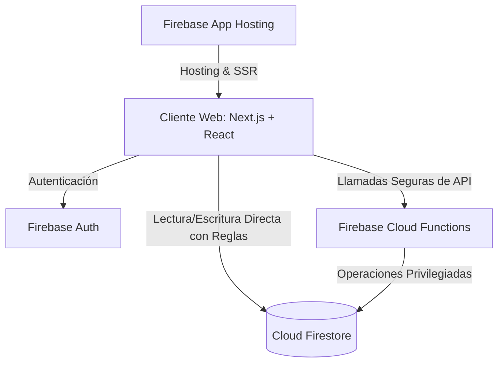

# Arquitectura del Sistema - Ninja Dojo

Este documento proporciona una visión detallada de los componentes del sistema, el modelo de seguridad, el diseño de la base de datos y la estructura de archivos de Ninja Dojo.

---

## 1. Vista General de Componentes

Ninja Dojo está diseñado bajo una arquitectura serverless híbrida compuesta por:



*   **Frontend (Next.js / React)**: SPA (Single Page Application) responsiva e interactiva con enrutamiento dinámico. Utiliza el Firebase Client SDK para escuchar actualizaciones en tiempo real (ej. notificaciones y cambios de estado de asistencia) y renderiza vistas personalizadas basadas en el rol del usuario actual.
*   **Servicio de Autenticación (Firebase Auth)**: Maneja el inicio de sesión federado (Google) y provee tokens JWT para identificar de forma segura a los usuarios en el frontend y backend.
*   **Base de Datos (Cloud Firestore)**: Base de datos NoSQL documental y en tiempo real. Configurada con reglas de seguridad estrictas para restringir lecturas y escrituras no autorizadas.
*   **Backend Serverless (Firebase Cloud Functions - Node.js 22)**: Provee una API HTTP centralizada (`api`) para realizar operaciones privilegiadas de administración (como reasignación de roles de usuario, generación de invitaciones y reportes consolidados) garantizando el cumplimiento de reglas de negocio difíciles de modelar con reglas puras de Firestore.
*   **Infraestructura de Hosting (Firebase App Hosting)**: Alojamiento optimizado con Server-Side Rendering (SSR) y CI/CD integrado directamente con repositorios de GitHub.

---

## 2. Modelo de Seguridad y Control de Acceso (RBAC)

El sistema implementa un modelo de Control de Acceso Basado en Roles (RBAC) con tres niveles jerárquicos:

1.  **Administrador (`admin`)**:
    *   Control total sobre todos los perfiles de usuario.
    *   Capacidad para aprobar/rechazar cuentas pendientes.
    *   Habilitado para crear/borrar materias e inscribir/desinscribir manualmente a docentes.
2.  **Profesor (`teacher`)**:
    *   Gestión completa de las materias en las que figura como docente (titular o ayudante).
    *   Habilitado para crear clases, regenerar cronogramas, redactar tareas y publicar avisos.
    *   Acceso a ver el listado de lecturas y acuses de recibo de avisos de sus estudiantes.
3.  **Estudiante (`student`)**:
    *   Lectura de materias en las que está inscripto.
    *   Visualización de clases y avisos de sus cursos correspondientes.
    *   Posibilidad de confirmar el acuse de recibo de avisos y realizar entregas de tareas asignadas.

### Implementación Técnica de Seguridad:
*   **Reglas de Firestore (`firestore.rules`)**:
    *   Denegación por defecto: todo lo no listado explícitamente queda inaccesible para el cliente.
    *   **Perfiles (`profiles`)**: cada usuario solo puede leer su propio perfil (el aprovisionamiento ocurre en el backend). Docentes y administradores únicamente pueden editar el mapa de comisiones sobre perfiles de estudiantes.
    *   **Membresía de curso**: se valida mediante IDs predecibles — `course_teachers/{courseId}_{uid}`, `course_roster/{courseId}_{uid}` y `enrollments/{uid}_{courseId}` — usando `exists()`, sin lecturas extra.
    *   **Subcolecciones de cursada**: asistencia legible por miembros y escribible solo por docentes asignados; sesión QR (`active_qr`, con su secreto TOTP) solo accesible desde el backend; foros Q&A con updates restringidos a reacciones (participantes) o marca de mejor respuesta (docente); encuestas anónimas validadas por rating 1-5.
    *   **Colecciones privilegiadas**: `submissions`, `audit_logs`, `activity_logs`, `backups`, avisos, notificaciones, tutorías y configuración global no aceptan escrituras directas del cliente; se operan exclusivamente vía Cloud Functions con SDK admin.
*   **Cloud Functions API**:
    *   La acción callable única (`api`) aplica primero un rate limit por usuario (`functions/src/lib/rateLimit.js`, contadores en `rate_limits` con TTL; grupos más estrictos para QR, correos y tareas pesadas) y valida el payload contra el esquema Zod de la acción (`functions/src/schemas.js`; sin esquema, se rechaza). Las acciones que escriben objetos del cliente (`updateCourseSettings`, `updateUserProfile`) usan listas blancas estrictas.
    *   Luego decodifica el token de autenticación del llamador, resuelve su perfil y, antes de despachar al módulo (`functions/src/actions.js`), aplica la política de acceso declarada para esa acción en `functions/src/authz.js`: `AUTHENTICATED`, `STAFF`, `ADMIN`, `staffOf(...)` o `memberOf(...)`. Las políticas de curso resuelven el curso desde el payload o desde el documento referenciado (tarea, entrega, aviso, correo programado, grupo) y validan membresía con los mismos IDs predecibles que las reglas. Una acción sin política se rechaza (`permission-denied`) y un test verifica que registro y políticas coincidan.
    *   Los estudiantes reciben una proyección del curso sin `sync_secret`, códigos de invitación docentes ni credenciales, y del roster solo datos básicos de sus compañeros.
    *   **Credenciales en reposo**: `courses.github_token` y los tokens de `gmail_credentials` se guardan cifrados con AES-256-GCM (`enc:v1:…`, contexto del documento como AAD) con la clave `DOJO_ENCRYPTION_KEY` de Secret Manager. `getCourseSettings` nunca devuelve el token: solo `github_token_set`.

### Autenticación de las rutas App Router (`src/app/api/`):

Cada ruta usa exactamente un esquema, centralizado en `src/app/api/middleware/api.ts`:

| Esquema | Helper | Rutas | Consumidor |
|---|---|---|---|
| Token de suscripción por curso (`sync_secret`, solo equipo docente) | `requireCourseSubscriptionToken` | `/api/calendar`, `/api/export/csv` | Google Sheets / clientes iCal |
| Token de calendario por curso (`calendar_secret`, de solo lectura) | `requireCourseSubscriptionToken(..., { allowCalendarToken: true })` | `/api/calendar` | Clientes iCal de estudiantes |
| Bearer JWT de Firebase Auth | `requireBearerUser` / `requireBearerProfile` | `/api/me`, `/api/cli/*` | Dojo CLI (modo cloud) y futuras rutas con identidad de usuario |
| `id_token` de la plataforma LTI (decodificado, **sin verificación de firma** todavía) | lectura de claims | `/api/lti/*` | Moodle 4.2+ |

Convención: toda nueva ruta que actúe en nombre de un usuario debe usar `requireBearerProfile` (identidad + perfil para decisiones por rol) y jamás exponer `sync_secret`, códigos de invitación ni datos de terceros. Los tokens se comparan en tiempo constante.

Como el `id_token` LTI no se verifica contra el JWKS de la plataforma, los parámetros del launch solo se usan para navegar: ninguna decisión de acceso se basa en ellos (ver `moodleAutoEnroll`).

---

## 3. Esquema de Base de Datos (Firestore)

El sistema organiza los datos en colecciones de documentos NoSQL. A continuación se detalla su esquema lógico:

### Colección: `profiles`
Almacena el perfil general del usuario al registrarse por primera vez.
```json
{
  "full_name": "Nombre Apellido",
  "email": "usuario@unrn.edu.ar",
  "role": "student | teacher | admin",
  "account_status": "pending | approved | rejected",
  "matricula_unrn": "UNRN-XXXXX"
}
```

### Colección: `courses`
Define una materia o cátedra dentro de la plataforma.
```json
{
  "name": "Nombre de la Materia",
  "github_org": "organizacion-github-catedra",
  "teacher_id": "teacher123",
  "created_at": "timestamp"
}
```

### Colección: `course_teachers`
Relación N-a-N que asigna profesores y ayudantes auxiliares a una cátedra.
```json
{
  "course_id": "course123",
  "teacher_id": "teacher123",
  "role": "titular | ayudante"
}
```

### Colección: `enrollments` y `course_roster`
Doble validación de inscripción de un estudiante a una cátedra para evitar desvanecimientos en consultas reactivas.
```json
{
  "course_id": "course123",
  "student_id": "student123",
  "enrolled_at": "timestamp"
}
```

### Colección: `classes`
Instancias individuales de clases correspondientes al cronograma del curso.
```json
{
  "course_id": "course123",
  "number": 1,
  "date": "2026-06-01",
  "time": "10:00",
  "topic": "Tema de la Clase",
  "description": "Texto markdown explicativo...",
  "type": "Teórica | Práctica | Feriado | Especial",
  "meet_url": "https://meet.google.com/xyz",
  "presentation_url": "https://docs.google.com/...",
  "recording_url": "https://youtube.com/watch?v=..."
}
```

### Colección: `announcements`
Avisos y comunicados enviados por los docentes de una cátedra.
```json
{
  "course_id": "course123",
  "title": "Título del Aviso",
  "content": "Cuerpo del aviso en texto plano o markdown...",
  "author_id": "teacher123",
  "author_name": "Kakashi Hatake",
  "created_at": "timestamp"
}
```

### Colección: `announcement_acks`
Registro de acuse de recibo de avisos completado por los estudiantes.
```json
{
  "announcement_id": "announcement123",
  "student_id": "student123",
  "student_name": "Naruto Uzumaki",
  "student_email": "naruto@jutsu.com",
  "confirmed_at": "timestamp"
}
```

### Colección: `class_comments`
Subcolección dentro de cada clase para almacenar comentarios del foro Q&A con soporte de soluciones del docente y reacciones.
```json
{
  "class_number": 1,
  "author_id": "student123",
  "author_name": "Naruto Uzumaki",
  "content": "Consulta sobre Git...",
  "created_at": "timestamp",
  "reactions": { "👍": ["student123"], "🎉": [] },
  "is_solution": true
}
```

### Colección: `attendance`
Registros de presentismo de los estudiantes.
```json
{
  "course_id": "course123",
  "student_id": "student123",
  "class_number": 1,
  "status": "present | absent | late",
  "recorded_at": "timestamp"
}
```

### Colección: `assignments`
Entregas y tareas académicas publicadas.
```json
{
  "course_id": "course123",
  "title": "Práctica Git",
  "description": "Consignas...",
  "template_repo": "owner/repo",
  "due_date": "2026-05-01",
  "is_required": true,
  "created_at": "timestamp"
}
```
`due_date` vence a las 23:59:59 de Argentina; la tolerancia en horas corridas sale de `grading_rules`. `is_required: false` marca un TP optativo (no cuenta para regularizar).

### Colección: `submissions`
Entregas de tareas hechas por los alumnos.
```json
{
  "assignment_id": "assign123",
  "student_id": "student123",
  "github_repo": "student/repo",
  "status": "submitted | graded",
  "grade": 9,
  "feedback": "Buen trabajo...",
  "submitted_at": "timestamp",
  "late": false,
  "late_by_hours": 0
}
```
`late` (*Fuera de término*) se calcula al entregar con la tolerancia de la comisión y las prórrogas individuales.

### Colección: `notifications`
Avisos, alertas de inactividad, respuestas de tutorías o advertencias de riesgo.
```json
{
  "student_id": "student123",
  "message": "Mensaje de alerta...",
  "link": "/dashboard/courses/course123",
  "read": false,
  "created_at": "timestamp"
}
```

### Colección: `study_groups`
Grupos de estudio formados por estudiantes con preferencias horarias de cursada.
```json
{
  "course_id": "course123",
  "name": "Los Ninjas del Código",
  "description": "Estudiamos algoritmos...",
  "schedule_pref": "Mañana | Tarde | Noche",
  "members": ["student123", "student456"],
  "created_by": "student123",
  "created_at": "timestamp"
}
```

### Colección: `tutors`
Perfiles postulados para tutorías entre pares en la cursada.
```json
{
  "course_id": "course123",
  "student_id": "student123",
  "name": "Sasuke Uchiha",
  "strong_topics": "Backend, TypeScript",
  "availability": "Viernes 18:00",
  "created_at": "timestamp"
}
```

### Colección: `tutoring_sessions`
Reservas e historial de mentorías programadas y confirmadas.
```json
{
  "course_id": "course123",
  "tutor_id": "student123",
  "student_id": "student456",
  "topic": "Dudas sobre Nest.js",
  "date_time": "2026-07-20T18:00:00",
  "status": "requested | confirmed | cancelled",
  "meet_url": "https://meet.google.com/abc-defg-hij",
  "created_at": "timestamp"
}
```

### Colección: `schedule_versions`
Snapshots de planificación de cronogramas.
```json
{
  "course_id": "course123",
  "name": "Versión Inicial",
  "class_instances": [ { "topic": "Tema...", "date": "..." } ],
  "created_by": "teacher123",
  "created_at": "timestamp"
}
```

### Colección: `backups`
Puntos de restauración global del sistema creados por los administradores.
```json
{
  "courses": [ { "id": "course123", "name": "..." } ],
  "assignments": [ { "id": "assign123", "title": "..." } ],
  "profiles": [ { "id": "user123", "full_name": "..." } ],
  "created_by": "admin123",
  "created_by_name": "Minato Namikaze",
  "created_at": "timestamp"
}
```

### Colección: `audit_logs`
Logs históricos detallando modificaciones sobre calificaciones (calificaciones inline en GitHub o trabajos prácticos).
```json
{
  "course_id": "course123",
  "submission_id": "sub123",
  "editor_id": "teacher123",
  "editor_name": "Kakashi Hatake",
  "diff": {
    "old": { "grade": 7, "feedback": "bueno" },
    "new": { "grade": 9, "feedback": "excelente refactor" }
  },
  "created_at": "timestamp"
}
```

### Cursada: reglas, parciales, excepciones y condición

Solo backend (denegadas a todo cliente en `firestore.rules`); el motor puro está en `functions/src/lib/academic/` y lo comparten la callable `api` y `/api/export/csv`.

*   `courses/{id}.grading_rules` y `grading_rules_by_commission[comision]`: asistencia mínima, nota de aprobación y de promoción, % de TPs en OK, máximo de entregas tardías, TPs exceptuables, tolerancia (horas corridas) y si se promociona por recuperatorio. Solo el titular las edita; cada cambio queda en `audit_logs`.
*   `assessments/{id}`: `{ course_id, kind: "parcial" | "recuperatorio", label, recovers, date, commission, archived }`.
*   `assessment_grades/{assessmentId}_{uid}`: `{ course_id, assessment_id, student_id, grade, absent, feedback, graded_by }`.
*   `course_exceptions/{id}`: `{ course_id, student_id, type: "attendance_waiver" | "tp_exempt" | "deadline_extension", assignment_id, extra_hours, reason, revoked }`. Se revocan, no se borran.
*   La condición (`Promocionado`, `Regular`, `Condicional`, `EN RIESGO`, `Ausente`, `Baja`) no se persiste: se calcula con `getAcademicConditions` / `getMyAcademicCondition` y es provisional hasta el cierre de cursada.

### LTI 1.3 Advantage (`functions/src/lib/lti/`, rutas `/api/v1/lti/*`)

Librería sin dependencias, compartida por Next (login OIDC, launch, JWKS, Deep Linking, registro dinámico) y Cloud Functions (NRPS, AGS). Todo backend-only:

*   `lti_platforms/{hash(iss, client_id)}`: emisor, client_id, deployments, URLs, `course_ids`, `status: pending | approved | disabled`. La registra el titular; la aprueba un admin. Sin aprobación no hay launches docentes ni vínculo con cuentas existentes.
*   `lti_states` (state + nonce de un login, un uso, TTL), `lti_handoffs` (código de 2 minutos que `/lti/continuar` canjea por un custom token), `lti_deep_link_sessions`, `lti_registrations` (URL de registro dinámico de un uso).
*   `lti_users/{hash(iss, sub)}` → uid; `lti_contexts/{hash}`: curso de Moodle → cátedra, con las URLs de NRPS y AGS y el checksum del último padrón.
*   El launch verifica RS256 contra el JWKS de la plataforma, `iss`, `aud`/`azp`, `exp`, nonce, state y `deployment_id`; nunca otorga el rol de administrador ni vincula cuentas de administradores.

### Retención (`functions/src/lib/academic/alerts.js`)

*   `student_alerts/{courseId}_{uid}_{tipo}`: `attendance_critical`, `overdue_tps`, `no_repo`, `silent_dropout`, con estado `active | contacted | snoozed | resolved`. Recalculadas a diario (`refreshAlertsDaily`) y a pedido.
*   `contact_logs`: bitácora inmutable (canal, resumen, docente); los correos directos y las tutorías agendadas se registran solos.
*   `review_requests`: consultas del estudiante sobre su ficha, con hilo de mensajes.
*   `moodle_events/{hash}`: logs CSV de Moodle importados sin duplicar; alimentan `profiles.ultima_actividad_moodle`.
*   `githubEvents` (Cloud Function): webhook de la organización (HMAC `X-Hub-Signature-256`, `processed_webhooks`) que pasa las entregas a `submitted`, `changes_requested` o `approved`.

### URLs semánticas (`functions/src/lib/routes.js`)

`/{asignatura}/{año}/{cuatrimestre}/{comision}/{vista}`, `/estudiantes/st_…[/asistencias|/practicas/{tp}]` y `/admin/configuracion`. `course_slugs/{slug}__{año}__{cuatrimestre}` garantiza unicidad; `student_public_ids/{st_…}` → uid. Las páginas son clientes que resuelven la ruta con `resolveCourseRoute` después de autenticar; los uid nunca aparecen en la URL ni en el HTML.

---

## 4. Estructura de Directorios del Código Fuente

El repositorio está estructurado para independizar la lógica de despliegue del frontend de la del backend serverless:

```
├── .firebase/                  # Archivos temporales de despliegue Firebase
├── docs/                       # Documentación técnica y de diagramas
│   ├── ARCHITECTURE.md         # (Este archivo) Estructura y arquitectura del sistema
│   ├── CASOS_DE_USO.md         # Escenarios detallados por rol de usuario
│   ├── DEVELOPMENT.md          # Setup, convenciones, pruebas y seed
│   ├── ROADMAP.md              # Estado verificado, backlog e hitos
│   ├── RUNBOOK_DESPLIEGUE_CSV.md # Acciones manuales de despliegue operativo
│   └── UML.md                  # Diagramas Mermaid (Casos de Uso, Secuencias)
├── functions/                  # Backend: Firebase Cloud Functions (Node.js 22)
│   ├── index.js                # Router callable (api) + endpoints onRequest
│   ├── src/modules/            # Dominios: auth, course, github, mail, moodle, etc.
│   ├── tests/                  # Suite Jest (128 pruebas unitarias)
│   └── package.json            # Dependencias del backend
├── manual/                     # Manual de usuario (docentes, estudiantes, admins)
├── public/                     # Recursos estáticos del frontend
├── src/                        # Frontend: Next.js 16 (App Router) + React 19
│   ├── app/                    # Rutas: /login, /dashboard, /api/{calendar,export/csv,me,cli,lti}
│   ├── components/dashboard/ui # Design System (BaseModal, AlertBadge, Toasts)
│   ├── lib/                    # Clientes firebase, helpers de API y logging
│   └── modules/                # Módulos de dominio con componentes/hooks/utils
├── tests/selenium/             # Suite E2E Selenium WebDriver (14 módulos)
├── firestore.rules             # Reglas de seguridad RBAC de Firestore
├── firestore.indexes.json      # Índices compuestos de base de datos
└── firebase.json               # Configuración de servicios de Firebase CLI
```
