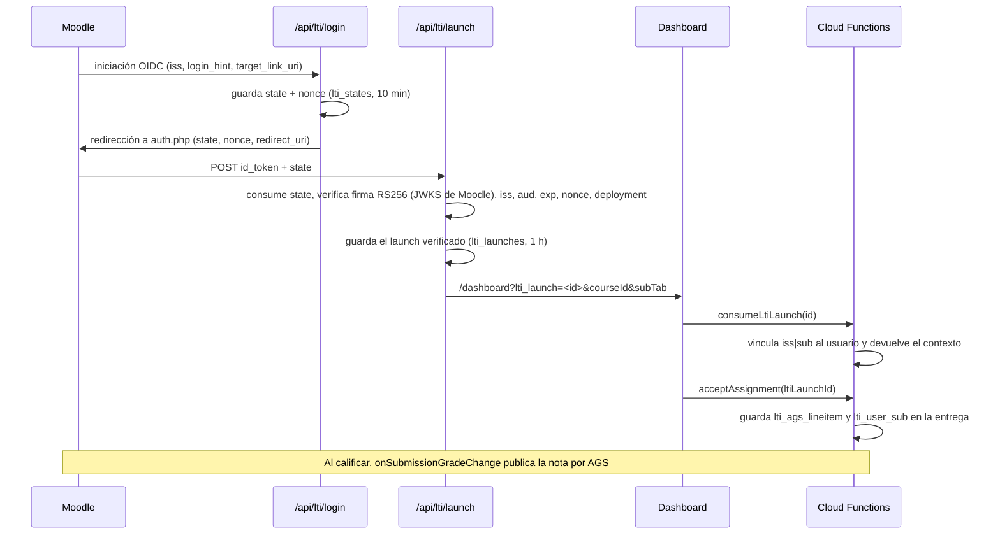

# Integración con Moodle (4.2+)

Ninja Dojo se integra con Moodle de dos maneras:

1. **LTI 1.3 Advantage**: Moodle abre Ninja Dojo como herramienta externa (con login OIDC y token firmado), los docentes insertan módulos por **Deep Linking** y las notas vuelven al libro de calificaciones por **AGS** (Assignment and Grade Services).
2. **Moodle Web Services (REST)**: desde **Ajustes Cátedra → Integración Moodle**, el docente sincroniza alumnos, importa contenidos y exporta notas o un respaldo XML usando un `wstoken` que no se guarda.

Además, el feed iCal de cada cátedra (`/api/calendar?id=…&token=…`) se puede suscribir como calendario externo en Moodle.

---

## 1. Flujo LTI 1.3

**Garantías:**

- El `id_token` se acepta solo con firma RS256 válida contra el JWKS de la plataforma configurada, emisor y audiencia correctos, vigente, con un `nonce` emitido por Ninja Dojo y un `state` de un solo uso.
- Ningún dato del launch viaja por la URL del dashboard: solo un ID que el backend canjea una única vez y queda ligado al usuario que lo usó.
- La URL de notas (line item de AGS) sale del launch verificado. El navegador ya no puede proponer una.
- Solo los roles docentes de Moodle (`Instructor`, `Administrator`, `ContentDeveloper`, `TeachingAssistant`) pueden usar Deep Linking.
- La inscripción automática (`moodleAutoEnroll`) sigue creando inscripciones `pending` y nunca otorga rol docente.

**Sin LTI 1.3 configurado** (por ejemplo, con el simulador `public/test-lti.html`), `/api/lti/launch` solo navega: no toma identidad, roles ni URLs de notas del pedido.

## 2. Configuración

### 2.1. En Moodle

*Administración del sitio → Extensiones → Actividades → Herramienta externa → Gestionar herramientas → Configurar una herramienta manualmente*:

| Campo | Valor |
|---|---|
| Versión LTI | LTI 1.3 |
| URL de la herramienta | `https://<dominio>/api/lti/launch` |
| Tipo de clave pública | URL del conjunto de claves (Keyset URL) |
| URL del keyset público | `https://<dominio>/api/lti/jwks` |
| URL de inicio de sesión | `https://<dominio>/api/lti/login` |
| URI de redireccionamiento | `https://<dominio>/api/lti/launch` |
| Soporta Deep Linking | Sí — URL de selección de contenido: `https://<dominio>/api/lti/launch` |
| Servicios | IMS LTI Assignment and Grade Services: *Usar este servicio para sincronizar calificaciones*; Names and Role Provisioning: *Usar este servicio* |
| Privacidad | Compartir nombre y correo: *Siempre* |

Al guardar, Moodle muestra los datos de la plataforma: **ID de cliente**, **ID de despliegue**, **URL de la plataforma (issuer)**, **endpoint de autenticación**, **URL del keyset** y **URL del token de acceso**.

### 2.2. En Ninja Dojo

Con esos datos se configuran las variables del servidor:

| Variable | Dónde | Valor (Moodle) |
|---|---|---|
| `LTI_PLATFORM_ISSUER` | App Hosting | URL de la plataforma (p. ej. `https://moodle.unrn.edu.ar`) |
| `LTI_CLIENT_ID` | App Hosting y `functions/.env.<proyecto>` | ID de cliente |
| `LTI_PLATFORM_AUTH_URL` | App Hosting | Endpoint de autenticación (`…/mod/lti/auth.php`) |
| `LTI_PLATFORM_JWKS_URL` | App Hosting | URL del keyset (`…/mod/lti/certs.php`) |
| `LTI_PLATFORM_TOKEN_URL` | `functions/.env.<proyecto>` | URL del token de acceso (`…/mod/lti/token.php`) |
| `LTI_DEPLOYMENT_IDS` | App Hosting | ID(s) de despliegue aceptados, separados por coma |
| `LTI_TOOL_PRIVATE_KEY` | Secret Manager (Functions y App Hosting) | Clave RSA privada de Ninja Dojo. La genera `scripts/setup-secrets.sh` |
| `LTI_TOOL_KID` | Opcional | Identificador de la clave (por defecto `dojo-lti-1`) |
| `NEXT_PUBLIC_APP_URL` | App Hosting | Dominio público de la app |

`/api/lti/jwks` publica la clave pública derivada de `LTI_TOOL_PRIVATE_KEY`. Si la clave cambia, Moodle la vuelve a leer del keyset.

### 2.3. Enlaces a actividades

Al agregar la herramienta externa en un curso de Moodle, el docente puede:

- Usar **Seleccionar contenido** (Deep Linking) y elegir un módulo de Ninja Dojo. Se inserta un enlace LTI con `targetModule` y `courseId` como parámetros personalizados.
- O definir a mano parámetros personalizados (`courseId=…`, `assignmentId=…`, `targetModule=assignments`).

## 3. Calificaciones (AGS)

Cuando una entrega aceptada desde un launch con AGS recibe una nota numérica, desde cualquier vía (UI, planilla, CSV o autograding), el trigger `onSubmissionGradeChange`:

1. Obtiene un token OAuth2 `client_credentials` con una aserción JWT firmada por Ninja Dojo (`scope …/lti-ags/scope/score`).
2. Publica `POST {lineitem}/scores` con la nota sobre 10 (`scoreMaximum: 10`), el comentario y `gradingProgress: FullyGraded`.
3. Registra el intento en `audit_logs` (`moodle_grade_sync`). Si falla por un error de red o de Moodle, el trigger se reintenta.

Las notas conceptuales («Aprobado») no tienen equivalente numérico y no se publican. Si la cátedra tiene Moodle deshabilitado, no se sincroniza nada.

## 4. Moodle Web Services (REST)

| Acción | Uso |
|---|---|
| `syncMoodleCourseRoster` | Importa el roster del curso de Moodle (`core_enrol_get_enrolled_users`). Omite la escritura si el padrón no cambió (checksum) |
| `syncMoodleCourseContents` | Trae secciones y temas como clases |
| `exportGradesToMoodleWebservice` | Exporta las notas de una tarea |
| `exportCourseToMoodleXml` | Respaldo XML de la cátedra |

Las URLs de Moodle se validan antes de usarse: HTTPS y hosts públicos, sin `localhost`, IPs privadas ni endpoints de metadata. El `wstoken` se envía en cada operación y no se persiste.
